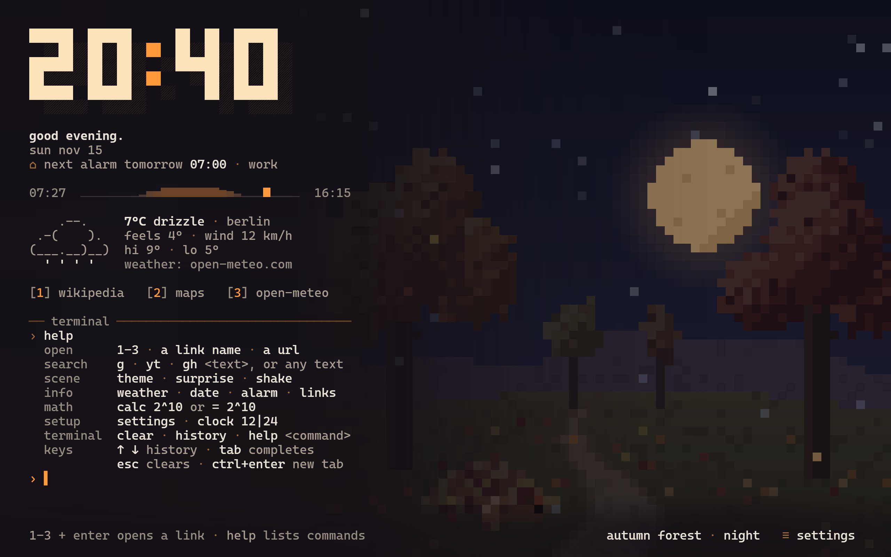
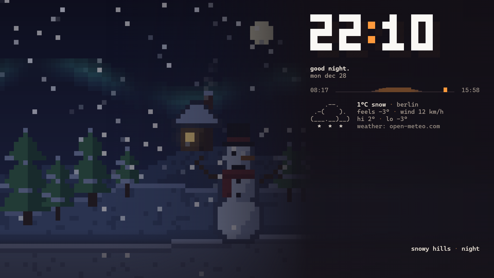
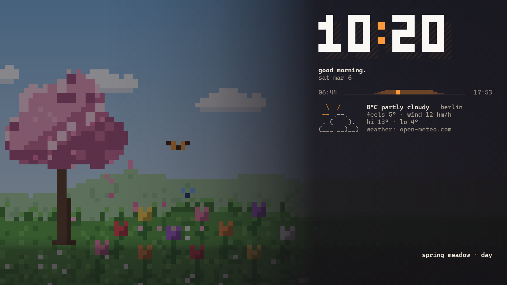
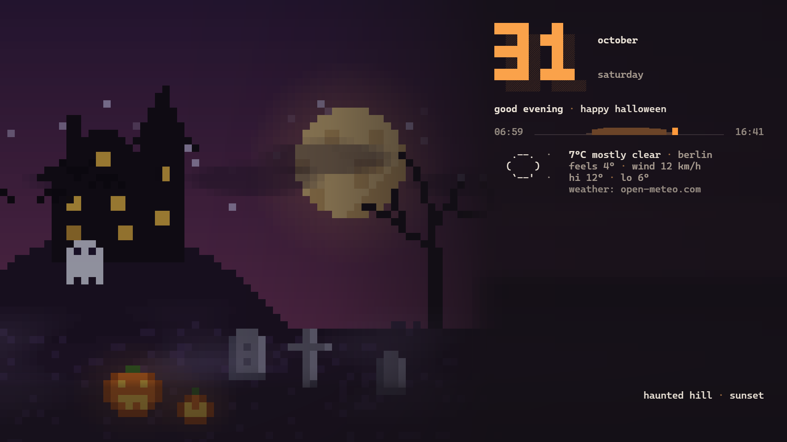

# cool-desktop

Pixel-art scenes for a Windows desktop: an animated Chrome new tab with a small terminal, a live wallpaper for Lively
and a still wallpaper. The scenes and the engine that draws them come from my
[PixelClock](https://github.com/tommysl8/PixelClock), a 64x64 LED pixel-art desk clock.

In Chrome and Lively it shows up as PixelClock Desktop.

```text
██████  ██████      ██  ██  ██████
    ██  ██  ██  ██  ██  ██  ██  ██
██████  ██  ██      ██████  ██  ██
██      ██  ██  ██      ██  ██  ██
██████  ██████          ██  ██████

good evening.
sun nov 15

[1] wikipedia   [2] maps   [3] open-meteo

── terminal ──────────────────────────
› theme snowy hills
```

The clock's engine is copied byte for byte into `vendor/pixelclock`. Here its scenes fill the screen, dimmed a
little, with a quiet column of text beside them: the time, the date, the weather and the day's light.









## What it does

There are three pieces, and the same engine draws the scene in all of them:

- a Chrome new tab: the scene fills the tab, and a column on the left holds the clock, the weather, your links and
  a small terminal;
- a live wallpaper for Lively Wallpaper: the same scene across the desktop, with the clock and the weather on the
  right, away from your icons;
- a still wallpaper: a picture of the scene, drawn again every 15 minutes, for when the battery matters.

All three follow the day and the year:

- The scene follows the calendar: snowy hills in winter, a spring meadow, a summer beach and an autumn forest, and
  on their days new year's eve, lunar new year, valentine's day, st. patrick's day, easter, the fourth of july,
  halloween, thanksgiving and christmas.
- The light follows your day: dawn, day, sunset and night, stretched to the real sunrise and sunset of your city,
  so the scene gets dark when it gets dark outside.
- The weather comes from the forecast: clouds dull the colours, rain and drizzle fall, snow drifts down, fog softens
  everything and thunder flashes now and then.
- A thin daylight strip shows the whole day, with sunrise and sunset at its ends and an amber mark for now.
- Every scene has a surprise when you shake it: click the scene or type `shake`. The wallpaper shakes on its own on
  the hour, from 10 am to midnight.

## Install

You need Windows 11, Google Chrome for the new tab and Lively Wallpaper (free, from the Microsoft Store) for the live
wallpaper. The build needs Node.js 22 or newer and Python 3.

1. Copy `config/user.example.json` to `config/user.json` and put in your city, units, clock and links.
2. Build: `node tools/build.mjs`
3. Install: `node tools/install.mjs`
4. Load the new tab in Chrome, add the wallpaper to Lively, or turn on the still wallpaper.

[INSTALL.md](INSTALL.md) walks through every step, and [UNINSTALL.md](UNINSTALL.md) takes it all out again.

## The terminal

The new tab's column ends in a small terminal. It has the keyboard as soon as the tab opens, so you can just type.

| type | and it |
|---|---|
| `1` to `9`, then Enter | opens that link; Ctrl+Enter, or a space and `&` at the end, opens it in a new tab |
| a link's name | opens that link |
| an address, like `example.com` | opens it |
| `g`, `yt` or `gh` and some words | searches Google, YouTube or GitHub |
| anything else | searches with Chrome's default search engine |
| `theme snowy hills`, `theme list`, `theme auto` | changes the scene, lists them all, or follows the date again |
| `surprise`, `shake` | picks a random scene for this tab, or shakes the scene |
| `weather`, `date`, `alarm`, `links` | shows the weather, the date and the sun, your clock's next alarm, or the links |
| `calc 2^10`, `= sqrt(2)*pi` | works it out |
| `clock 12`, `clock 24` | switches the clock |
| `settings` | opens the settings (Esc closes them) |
| `history`, `clear`, `help` | shows what you typed before, clears the screen, or lists everything (in a small window, `help more` shows the rest) |

| key | and it |
|---|---|
| ↑ and ↓ | walks through what you typed before |
| Tab | completes the word; a faint preview shows what it would add |
| Esc | clears the line, and on an empty line clears the screen |

## Privacy

On its own it only talks to Open-Meteo and, from the new tab, to your PixelClock on the local network
(`http://pixelclock.local`). Open-Meteo gets your city's name, to find it, and then its coordinates, for the weather
and the sunrise and sunset. Turn off both the weather and the real sunrise and sunset, and it asks Open-Meteo
nothing. There are no accounts, no analytics and no fonts or scripts from the web. The new tab keeps its settings in
Chrome's synced storage, so with Chrome sync on they follow your Chrome profile.

## Build and test

```text
node tools/build.mjs              build dist/, first refreshing the engine from ../PixelClock when it is there
node tools/build.mjs --no-sync    build from the copy in vendor/pixelclock as it is
node tools/validate.mjs           check what the build wrote
node --test "tests/*.test.mjs"    run the unit tests
node tools/sync.mjs               only copy the engine (from ../PixelClock, or PCD_PIXELCLOCK)
node tools/readme-shots.mjs       draw the pictures in docs/ again
```

`node tools/test-newtab.mjs` and `node tools/test-wallpaper.mjs` (after `node tools/build.mjs --no-sync wallpaper`)
run their piece in a hidden Chrome with a throwaway profile, `node tools/test-still.mjs` draws the still in Node
and checks it by its pixels, and `node tools/glyph-gate.mjs` measures every character the pieces draw. They use the
sample city Berlin and canned weather.

## Folders

```text
config/user.example.json    the settings the build starts from
design/                     the font and its licence, the colours, the still's glyph atlas and a page of the whole look
src/newtab/                 the Chrome new tab
src/wallpaper/              the Lively wallpaper
src/still/                  the still wallpaper and its scheduled task
src/shared/                 what the three share: the scene, the column, the weather and the ASCII bits
vendor/pixelclock/          the clock's scene engine, copied byte for byte
tools/                      build, validate, install, sync and the browser checks
tests/                      the unit tests
docs/                       the pictures above
```

## Credits

- The scenes, the calendar and the 3x5 digits come from the [PixelClock](https://github.com/tommysl8/PixelClock)
  engine in `vendor/pixelclock`.
- Weather data by [Open-Meteo.com](https://open-meteo.com/), under CC BY 4.0.
- Cascadia Mono, by Microsoft, under the SIL Open Font License 1.1 (`design/fonts/OFL.txt`).

## Licence

MIT (see [LICENSE](LICENSE)). The font keeps its own licence: SIL Open Font License 1.1, in `design/fonts/OFL.txt`.
